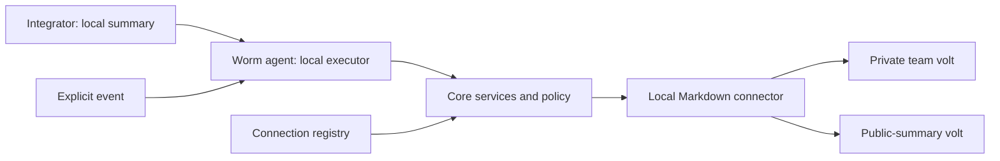

# WormVolt

## A living brain for your AI.

Your knowledge grows. You stay in control.

WormVolt is an early foundation for a living knowledge ecosystem built around
Markdown and Obsidian-compatible vaults. A **volt** combines readable knowledge
with a definition of its purpose, structure, access boundaries and permitted
behaviour.

Useful AI work should leave something behind: a decision explained, a discovery
captured, a better project summary. Connected volts can let those outcomes
accumulate and be reused across more tasks, while keeping personal, team and
public knowledge within deliberate boundaries.

The vision is knowledge you own and configuration you can carry forward as
models, providers and tools change. WormVolt's core requires no Obsidian
installation, AI provider, cloud account or running network service.

**Today:** this repository runs a small, deterministic local publication
example. It is a starting point for contributors, not a finished agent platform.
The project is intended to be open source; **the open-source licence is pending
owner selection**. No licence granting reuse permissions has been added. See the
[licensing decision](docs/decisions/0003-licensing-pending.md).

### How knowledge moves

A worm connection declares a route between volts, selecting records and
describing an allowed transformation. A worm agent executes that route within
core policy. Connectors access systems; integrators put the capabilities
together into useful workflows.

The longer-term direction is background capture, refinement and enrichment. At
agent task start, a workflow could prepare relevant, permitted context in a
working volt; useful task results could flow back after the appropriate checks.
This foundation handles explicit change and task-start events, but does not yet
discover relevant context, watch files, call models or capture task results
automatically.



The public-summary volt is a local directory marked for public information.
Running the example does **not** publish it to the internet.

### Try the working example

Prerequisites: Node.js 24 and pnpm 11.19.0. If pnpm is not installed, an
available npm installation can install the pinned CLI with
`npm install --global pnpm@11.19.0`. From your checkout:

```sh
pnpm install --frozen-lockfile
pnpm example
```

The example uses synthetic data and no credentials. It:

1. Validates both volt definitions and the single connection registry.
2. Reads a structured Markdown record from the private team-project volt.
3. Handles an explicit `knowledge.changed` event as a trusted local demo
   identity.
4. Checks source read, transform and share permissions, plus destination write
   and publish permissions and event autonomy.
5. Copies only the allowlisted `title` and `publicSummary` fields.
6. Validates the destination record and creates one complete Markdown file.
7. Records identifier-only provenance, with no private field content in logs.
8. Replays the event and reports `duplicate`, preserving the source file.

Output lives in `examples/local-volt-sync/public/knowledge/<job-id>.md` and is
ignored by Git. The first run reports `written` then `duplicate`; subsequent
runs report `duplicate` twice. Outcomes contain status codes and job IDs, not
knowledge payloads. You can read the Markdown directly in an editor or Obsidian.
The structured JSON fence is the prototype's supported record format; arbitrary
Markdown ingestion is not implemented.

**The allowlist is a field boundary, not a general-purpose text sanitizer.**
Only put reviewed, publishable text in the selected fields. Read the
[security model](docs/security-model.md) before adapting the example to real
data.

### Repository map

| Path                       | Responsibility                                                                                                       |
| -------------------------- | -------------------------------------------------------------------------------------------------------------------- |
| `packages/core`            | Versioned definitions, records, policy, storage contract and local storage, events, provenance, application services |
| `packages/worm-agents`     | Explicit event dispatch, bounded local retries and job outcomes                                                      |
| `packages/connectors`      | Capability-bearing adapters; local Markdown adapter implemented                                                      |
| `packages/integrators`     | Local summary workflow assembled from the other packages                                                             |
| `examples/local-volt-sync` | Runnable two-volt example and synthetic source data                                                                  |
| `templates`                | Conservative personal and team volt definitions                                                                      |
| `docs`                     | Concepts, architecture, security, extension guidance, roadmap and decisions                                          |
| `guides`                   | Documentation overview and the release-interface guide                                                                |
| `tests`                    | Behaviour and end-to-end verification                                                                                |

TypeScript and pnpm workspaces keep contracts visible across four small packages
with a shared toolchain and lockfile. Zod is the only external runtime
dependency. See [ADR 0001](docs/decisions/0001-typescript-workspaces.md).

### What works and what comes next

| Implemented                                                    | Planned                                                         |
| -------------------------------------------------------------- | --------------------------------------------------------------- |
| Strict version-1 definitions and canonical connection registry | Definition migration tooling and richer selection               |
| Separate read / transform / write / share / publish checks     | Authenticated identity providers and policy administration      |
| Local structured Markdown I/O and atomic create-if-absent      | Remote connectors and production durability guarantees          |
| Explicit change and task-start event execution                 | Watchers, durable queues, scheduling and automatic task capture |
| Deterministic allowlist projection and replay detection        | Reviewed enrichment providers and context preparation           |
| Hop limits and provenance-based loop checks                    | Stronger isolation, optional sidecars and deployed interfaces   |

No HTTP server, Git sync, chatbot endpoint or provider integration is shipped. A
sidecar is an optional deployment extension; an ordinary helper process alone is
not a security boundary.

### Build with us

```sh
pnpm check
pnpm build
```

`check` runs formatting/lint checks, strict TypeScript checks and the
behavioural test suite. Tests use temporary directories. Good first
contributions include improving validation diagnostics, adding adversarial
filesystem tests, proposing a record format evolution, and designing
authenticated identity or observation contracts before implementing remote
adapters.

Start with the [documentation overview](guides/README.md). That page links the
[release-interface guide](guides/release-interfaces.md),
[CONTRIBUTING.md](CONTRIBUTING.md), [concepts](docs/concepts.md),
[architecture](docs/architecture.md),
[extension guidance](docs/extension-guide.md) and the
[roadmap](docs/roadmap.md). For security issues, see [SECURITY.md](SECURITY.md).

### Optional help for established teams

Teams may arrange setup, integrations and ongoing maintenance through partner
vendors such as **AI AI Captain consultancy**. These services are optional and
separate from the open-source foundation. This repository makes no service,
availability or support guarantees and requires no commercial service to run.
